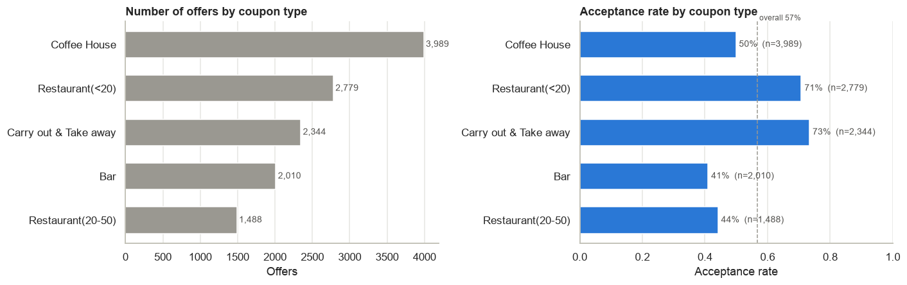
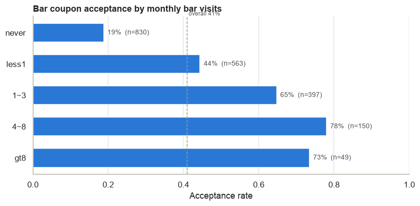
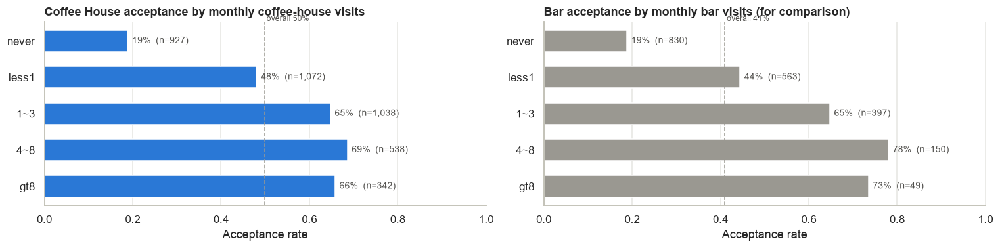
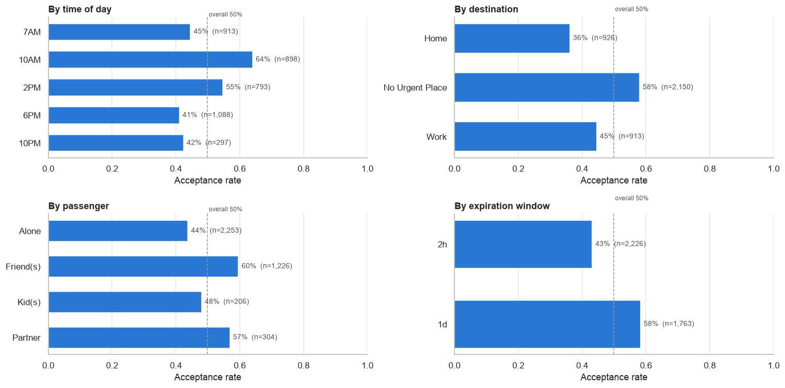
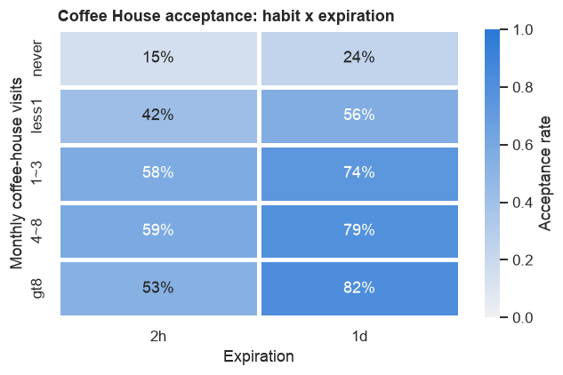
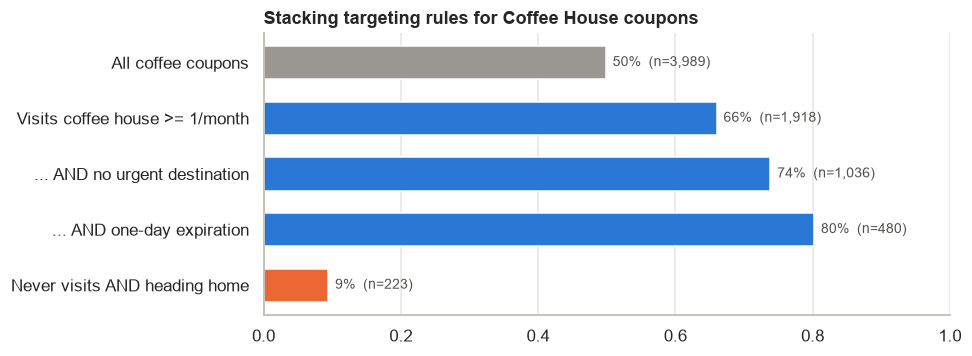

# Will the Customer Accept the Coupon?

An exploratory analysis of the UCI **In-Vehicle Coupon Recommendation** dataset: 12,684 survey scenarios in which a driver is offered a coupon for a nearby bar, coffee house, carry-out, cheap restaurant or mid-priced restaurant and says whether they would accept it.

The question: once a coupon is delivered, what separates the drivers who accept it from those who do not?

- Notebook: [assignment_5_1.ipynb](assignment_5_1.ipynb) (fully executed, all figures inline)
- Data: [data/coupons.csv](data/coupons.csv)
- Figures: [images/](images/)

## Summary of findings

**57% of all offers were accepted** (7,157 of 12,610 after removing duplicates). Acceptance is far from uniform across coupon types:



| Coupon | Offers | Acceptance |
|---|---|---|
| Carry out & Take away | 2,344 | 73% |
| Restaurant (< $20) | 2,779 | 71% |
| Coffee House | 3,989 | 50% |
| Restaurant ($20-50) | 1,488 | 44% |
| Bar | 2,010 | 41% |

Low-commitment food coupons convert best. Coffee House is the most frequently offered coupon and the closest to a coin flip, which makes it the most valuable one to target well.

### Bar coupons: habit is everything

Acceptance of bar coupons rises monotonically with how often the driver already goes to bars, from **19% for people who never go to about 75% for those who go more than three times a month**.



Every filter in the guided investigation is, in effect, a proxy for "already a bar-goer":

| Group | Acceptance | Everyone else |
|---|---|---|
| Goes to a bar > 3 times a month | 77% | 37% |
| Goes > once a month and over 25 | 70% | 33% |
| Goes > once a month, no kid in the car, not farming/fishing/forestry | 71% | 30% |
| Any of: (goes > once/month, no kid, not widowed) / (goes > once/month, under 30) / (cheap restaurants > 4/month and income < $50K) | 59% | 30% |

The third criterion in the last rule (cheap-restaurant diners with income under $50K) reaches only 45% on its own and dilutes the rule; it is a lifestyle proxy that has nothing to do with bars.

Two secondary factors modulate habit: **who is in the car** (a child drops acceptance to 21%, friends raise it to 56%) and **life stage** (drivers under 30 accept around 50%, those over 35 around 30-35%).

**Hypothesis:** drivers who accept bar coupons are people who already go to bars at least monthly, are typically under 30, and are not driving with a child. A coupon engine should target bar coupons at self-reported bar-goers, suppress them when a child is in the car, and expect weak returns on everyone else.

### Independent investigation: Coffee House coupons

Coffee House coupons (3,989 offers, 50% accepted) behave differently from bar coupons. Habit still matters, but it **saturates early**: people who never visit accept 19%, occasional visitors (less than monthly) accept 48%, and everyone who goes at least monthly accepts 65-69%. There is no extra lift from being a heavy user, so the addressable audience is much wider than for bars.



Context does most of the remaining work:



- **Time and destination.** 10AM is the best moment (64%), 2PM next (55%); the 7AM commute to work (45%) and the 6PM drive home (41%) are poor. Drivers with no urgent destination accept 58%, those heading home 36%. A coffee detour works when the driver has slack.
- **Expiration.** A one-day coupon is accepted 58% of the time versus 43% for a two-hour coupon, and the gap holds at every habit level. Coffee is a "later today" purchase.
- **Passenger.** Friends (60%) and partner (57%) beat driving alone (44%). Unlike bars, a child in the car does not hurt (48%).
- **Distance.** 55% within 15 minutes, 45% at 15-25 minutes, 35% beyond 25 minutes.
- **Demographics barely matter.** Gender is a wash, age is flat except at the extremes, income shows no consistent trend.



Stacking three rules produces a clear targeting segment:



| Segment | Offers | Acceptance |
|---|---|---|
| All coffee coupons | 3,989 | 50% |
| Visits a coffee house at least monthly | 1,918 | 66% |
| ... and has no urgent destination | 1,036 | 74% |
| ... and the coupon lasts one day | 480 | 80% |
| Never visits and is heading home | 223 | 9% |

**Recommendation:** send coffee coupons between 10AM and 2PM to drivers with any coffee habit, with a one-day expiry, and withhold them on the evening commute.

## Data cleaning

- `car` was 99% missing and was dropped.
- The five venue-frequency columns were missing in 1-2% of rows; they were left as missing and excluded only from the questions that use them.
- 74 exact duplicate rows were removed (repeated survey submissions).
- `passanger` was renamed `passenger`; `time`, `age`, `income`, `expiration` and the frequency columns were converted to ordered categoricals; the three cumulative distance flags were collapsed into one `distance` bucket.

## Next steps

Fit a per-coupon logistic regression or tree model to quantify these effects jointly and test interactions (habit x passenger, time x destination), then validate the targeting rules on a held-out split before using them to decide which coupons to send.

## Reproduce

```bash
python3 -m venv .venv && .venv/bin/pip install -r requirements.txt
.venv/bin/jupyter notebook assignment_5_1.ipynb
```

`build_notebook.py` regenerates and executes the notebook from scratch.

Data source: [UCI Machine Learning Repository, In-Vehicle Coupon Recommendation](https://archive.ics.uci.edu/dataset/603/in+vehicle+coupon+recommendation) (Wang et al., 2017).
